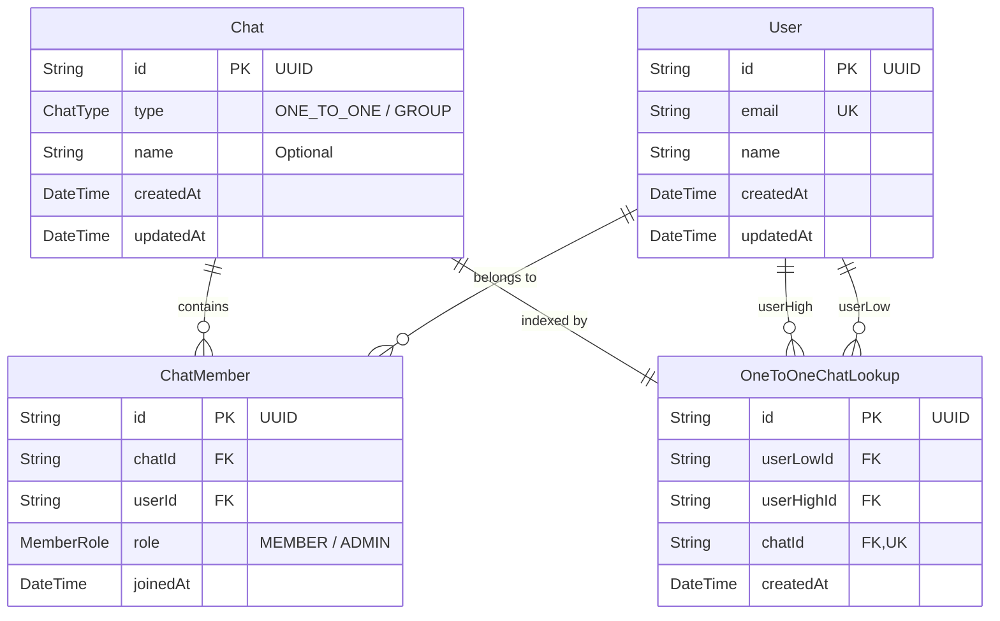

# 🚀 Chat Backend — Scalable Hybrid Real-Time Messaging API

A production-grade, enterprise-ready Chat Backend application architected with **Node.js**, **Express**, **TypeScript (Strict Mode)**, **PostgreSQL (Prisma ORM)**, and **Google Cloud Firestore (Firebase Admin SDK)**.

Built with a strict **4-tier layered architecture** (`Route -> Controller -> Service -> Repository -> Database`) and a dual-store strategy designed for high-concurrency real-time messaging platforms.

---

## 📑 Table of Contents

- [Architectural Overview](#-architectural-overview)
- [Dual-Store Strategy](#-dual-store-strategy)
- [System Architecture & Layers](#-system-architecture--layers)
- [Database Schema (PostgreSQL)](#-database-schema-postgresql)
- [NoSQL Data Model (Google Cloud Firestore)](#-nosql-data-model-google-cloud-firestore)
- [Technology Stack](#-technology-stack)
- [Prerequisites & Setup Guide](#-prerequisites--setup-guide)
- [Environment Variables](#-environment-variables)
- [Build & Run Commands](#-build--run-commands)
- [Automated Testing Suite](#-automated-testing-suite)
- [Complete API Reference](#-complete-api-reference)
  - [1. Create or Get 1-to-1 Chat](#1-create-or-get-1-to-1-chat)
  - [2. Send Message](#2-send-message)
  - [3. Get Messages (with Pagination)](#3-get-messages-with-pagination)
  - [4. Mark Message as Read](#4-mark-message-as-read)
  - [5. Update Last Seen Pointer](#5-update-last-seen-pointer)
  - [6. Get User Chats](#6-get-user-chats)
  - [Health Check Endpoint](#health-check-endpoint)
- [Security & Error Handling Conventions](#-security--error-handling-conventions)
- [Postman Collection](#-postman-collection)

---

## 🏗 Architectural Overview

This backend is designed around high performance, data consistency, and clear separation of concerns.

```text
[ Express HTTP Client / Mobile App / Web Frontend ]
                       │
                       ▼
          [ Global Security & Middleware ]
    (Helmet, CORS, Express-Rate-Limit, Morgan)
                       │
                       ▼
                 [ Controllers ]
     (Request validation, HTTP Status & Response)
                       │
                       ▼
                  [ Services ]
     (Business logic, Authorization, Transactions)
                       │
          ┌────────────┴────────────┐
          ▼                         ▼
 [ Relational Repositories ]  [ Firestore Repositories ]
          │                         │
          ▼                         ▼
   [ PostgreSQL (Prisma) ]   [ Cloud Firestore (Firebase) ]
 (Users, Chats, Membership)  (Messages, Reads, Last Seen)
```

---

## ⚖ Dual-Store Strategy

Modern messaging platforms have conflicting data requirements:
1. **User Identity & Chat Membership**: Strongly consistent, relational, foreign-key enforced, and queryable with relational joins.
2. **Messages, Receipts & Real-Time Presence**: High write throughput, millisecond read latency, horizontal partitioning, and auto-scaling time-series documents.

To solve this, the application implements a **Dual-Store Strategy**:

| Concern | Primary Store | Rationale |
|---|---|---|
| **Users & Authentication** | PostgreSQL (Neon / Prisma) | ACID compliance, unique email/username constraints, relational identity. |
| **1-to-1 Chat Relationship & Deduplication** | PostgreSQL (Neon / Prisma) | Atomic `$transaction` with canonical user ID ordering prevents duplicate 1-to-1 conversations under high concurrent requests. |
| **Chat Membership & Roles** | PostgreSQL (Neon / Prisma) | Relational integrity ensures members cannot be deleted without cascading or checks; membership queries are fast and strictly verified before message delivery. |
| **Chat Messages** | Cloud Firestore | Append-only document store with millisecond write latency, auto-indexing on `createdAt`, and effortless horizontal scaling. |
| **Read Receipts** | Cloud Firestore Subcollections | Distributed writes in `chats/{chatId}/messages/{messageId}/reads/{userId}` without updating the parent message document lock. |
| **Last Seen Pointers** | Cloud Firestore Subcollections | Fast key-value updates in `chats/{chatId}/lastSeen/{userId}` decouple user scroll position from relational tables. |

---

## 🏛 System Architecture & Layers

The codebase strictly isolates responsibilities into distinct tiers:

1. **Routes (`src/routes/`)**: Pure route declarations and middleware bindings.
2. **Middleware (`src/middleware/`)**:
   - `validateRequest`: Zod-based validation of `req.body`, `req.params`, and `req.query`.
   - `security.middleware`: Express rate limiting (`apiLimiter`, `messageLimiter`).
   - `errorMiddleware`: Centralized mapping of domain errors, Prisma errors (`P2002`, `P2025`, `P2003`), and Firebase errors.
3. **Controllers (`src/controllers/`)**: Thin HTTP handlers. Decoupled from database implementations; delegates immediately to services.
4. **Services (`src/services/`)**: Orchestrates business rules, cross-store data aggregation, authorization, and transactional boundaries.
5. **Repositories (`src/repositories/`)**: The **only** layer allowed to execute queries against PostgreSQL (via Prisma) and Cloud Firestore (via Firebase Admin SDK).

---

## 🗄 Database Schema (PostgreSQL)



---

## ☁ NoSQL Data Model (Google Cloud Firestore)

Real-time message data is stored hierarchically in Google Cloud Firestore:

```text
chats/ (Collection)
  └── {chatId}/ (Document)
        ├── messages/ (Subcollection)
        │     └── {messageId}/ (Document)
        │           ├── id: string
        │           ├── chatId: string
        │           ├── senderId: string
        │           ├── text: string
        │           ├── createdAt: Timestamp
        │           ├── isEdited: boolean
        │           ├── isDeleted: boolean
        │           └── reads/ (Subcollection)
        │                 └── {userId}/ (Document)
        │                       ├── userId: string
        │                       ├── messageId: string
        │                       ├── chatId: string
        │                       └── readAt: Timestamp
        │
        └── lastSeen/ (Subcollection)
              └── {userId}/ (Document)
                    ├── userId: string
                    ├── chatId: string
                    ├── lastSeenMessageId: string
                    └── lastSeenAt: Timestamp
```

---

## 🛠 Technology Stack

- **Runtime**: Node.js (v18+)
- **Language**: TypeScript Strict Mode (`noImplicitAny: true`, `strictNullChecks: true`, `noUncheckedIndexedAccess: true`)
- **Web Framework**: Express.js (v4.21+)
- **Relational ORM**: Prisma ORM (v6.19+)
- **Relational Database**: PostgreSQL (Neon Cloud DB)
- **NoSQL & Real-Time Engine**: Google Cloud Firestore via `firebase-admin` (v14.5+)
- **Schema Validation**: Zod (v3.24+)
- **Security**: Helmet, CORS, Express-Rate-Limit
- **Logging**: Morgan HTTP logger
- **Testing**: Native Node.js HTTP test harness executing against live databases

---

## 📦 Prerequisites & Setup Guide

### 1. Prerequisites
- **Node.js**: v18.0.0 or higher (Tested on Node v20 & v26)
- **npm**: v9.0.0 or higher
- **PostgreSQL Database**: Accessible PostgreSQL instance (Neon, Supabase, or Local PostgreSQL)
- **Google Cloud / Firebase Project**: Firestore database enabled in Native Mode

### 2. Installation
```bash
git clone <repository-url>
cd codes_for_tommorow
npm install
```

### 3. Environment Setup
Copy the template configuration file:
```bash
cp .env.example .env
```
Edit `.env` with your real database connection string and Firebase configuration.

### 4. Database Schema Sync & Initial Setup
Sync the schema to your PostgreSQL database and seed initial test users in one single command:
```bash
npm run db:setup
```
*(Or execute step-by-step)*:
```bash
npm run db:push     # Pushes Prisma schema to PostgreSQL (creates users, chats, chat_members tables)
npm run db:seed     # Pre-populates 3 test users (Alice, Bob, Charlie)
```

### 5. Firebase Credentials Setup
Place your Firebase Admin SDK service account key JSON at:
```text
credentials/serviceAccountKey.json
```
*(Note: `credentials/` is strictly ignored by `.gitignore` to prevent credential exposure).*

### 6. User Provisioning & Database Seeding
To start testing chat APIs, users must exist in PostgreSQL. You have 3 straightforward options:

- **Option A: One-Click Seed Script (Recommended for Reviewers)**:
  Run the pre-configured seed script to automatically wipe test data and seed 3 fresh users (Alice, Bob, and Charlie):
  ```bash
  npm run db:seed
  # or
  npm run db:reset
  ```
  The script will output their exact generated UUIDs directly in the terminal for copy-pasting.

- **Option B: Create Users via REST API**:
  Use the built-in user creation API endpoint:
  ```bash
  curl -X POST http://localhost:5000/user/create \
    -H "Content-Type: application/json" \
    -d '{"name": "Alice Sharma", "email": "alice@example.com"}'
  ```

- **Option C: Automated End-to-End Suite**:
  Run `npm run test:e2e` which automatically creates isolated test users, executes all 14 assertions, and validates the entire workflow.

---

## ⚙ Environment Variables

All environment variables are validated at startup via Zod in `src/config/env.config.ts`:

| Variable | Type | Required | Default | Description |
|---|---|---|---|---|
| `PORT` | Number | No | `5000` | HTTP server listening port |
| `NODE_ENV` | Enum | No | `development` | Environment mode (`development`, `production`, `test`) |
| `DATABASE_URL` | String | **Yes** | — | PostgreSQL connection URI |
| `FIREBASE_SERVICE_ACCOUNT_PATH` | String | Recommended | `credentials/serviceAccountKey.json` | Relative path to Firebase service account JSON |
| `FIREBASE_PROJECT_ID` | String | Optional | — | Alternative: Cloud project ID |
| `FIREBASE_CLIENT_EMAIL` | String | Optional | — | Alternative: Client email |
| `FIREBASE_PRIVATE_KEY` | String | Optional | — | Alternative: RSA Private Key string |
| `DISABLE_RATE_LIMIT` | Boolean | No | `false` | Set to `true` to disable rate limiting for high-throughput testing |

---

## 🚀 Build & Run Commands

```bash
# Run in development mode with auto-reload
npm run dev

# Compile TypeScript strict build to /dist
npm run build

# Start production server from /dist
npm start

# Run TypeScript linter / type checker
npm run lint
```

---

## 🧪 Automated Testing Suite

The project includes isolated, automated test suites verifying every phase against live PostgreSQL and Google Cloud Firestore instances:

```bash
# 1. Master End-to-End Verification Suite (All 14 assertions)
npm run test:e2e

# 2. Security Suite (Helmet, Rate Limits, Validation, Stack Protection)
npm run test:security

# 3. Phase 8 Suite (User Chats List with Previews)
npm run test:phase8

# 4. Phase 7 Suite (Last Seen Message Pointers)
npm run test:phase7

# 5. Phase 6 Suite (Read Receipts & Idempotency)
npm run test:phase6

# 6. Phase 5 Suite (Send & Get Messages with Pagination)
npm run test:phase5

# 7. Phase 4 Suite (Create 1-to-1 Chat & Deduplication)
npm run test:phase4

# 8. Database Health & Connectivity Tests
npm run db:test
npm run firebase:test
```

---

## 📖 Complete API Reference

All successful responses follow the uniform JSON envelope:
```json
{
  "success": true,
  "data": { ... },
  "message": "Human readable success message"
}
```

All error responses follow the standard error envelope:
```json
{
  "success": false,
  "error": {
    "code": "ERROR_CODE",
    "message": "Human readable error description",
    "details": [ ... ]
  }
}
```

---

### 0. Create User (User Provisioning Endpoint)

Creates a new user record in PostgreSQL to participate in chat conversations.

- **URL**: `POST /user/create` (or `POST /api/user/create`)
- **Headers**: `Content-Type: application/json`
- **Request Body**:
```json
{
  "name": "Alice Sharma",
  "email": "alice@example.com"
}
```

#### Executable cURL:
```bash
curl -X POST http://localhost:5000/user/create \
  -H "Content-Type: application/json" \
  -d '{"name": "Alice Sharma", "email": "alice@example.com"}'
```

#### Success Response (`201 Created`):
```json
{
  "success": true,
  "data": {
    "id": "524bc214-8d73-4086-bf08-b0ece4a5a3ce",
    "name": "Alice Sharma",
    "email": "alice@example.com",
    "createdAt": "2026-11-24T05:25:00.000Z",
    "updatedAt": "2026-11-24T05:25:00.000Z"
  },
  "message": "User created successfully"
}
```

---

### 1. Create or Get 1-to-1 Chat

Creates a new 1-to-1 chat between two users in PostgreSQL, or returns the existing chat idempotently.

- **URL**: `POST /chat/create` (or `POST /api/chat/create`)
- **Headers**: `Content-Type: application/json`
- **Request Body**:
```json
{
  "userAId": "11cf9ae0-fd32-47b4-950e-08bdd110c67a",
  "userBId": "3d01b685-f3e3-447d-8e7d-09bb53ce5f48"
}
```

#### Executable cURL:
```bash
curl -X POST http://localhost:5000/chat/create \
  -H "Content-Type: application/json" \
  -d '{"userAId": "11cf9ae0-fd32-47b4-950e-08bdd110c67a", "userBId": "3d01b685-f3e3-447d-8e7d-09bb53ce5f48"}'
```

#### Success Response (`201 Created` or `200 OK` if existing):
```json
{
  "success": true,
  "data": {
    "chatId": "33bfd5d7-fb45-4145-8c02-698ab0dcfdb8",
    "type": "ONE_TO_ONE",
    "isExisting": false,
    "members": [
      {
        "userId": "11cf9ae0-fd32-47b4-950e-08bdd110c67a",
        "role": "MEMBER",
        "name": "Alice User",
        "email": "alice@example.com"
      },
      {
        "userId": "3d01b685-f3e3-447d-8e7d-09bb53ce5f48",
        "role": "MEMBER",
        "name": "Bob User",
        "email": "bob@example.com"
      }
    ],
    "createdAt": "2026-11-24T05:25:01.000Z"
  },
  "message": "Chat created successfully"
}
```

---

### 2. Send Message

Validates chat existence and sender membership in PostgreSQL, then saves the message to Google Cloud Firestore.

- **URL**: `POST /chat/:chatId/message/send`
- **Rate Limit**: 30 requests / minute
- **Headers**: `Content-Type: application/json`
- **Request Body**:
```json
{
  "senderId": "11cf9ae0-fd32-47b4-950e-08bdd110c67a",
  "text": "Hello Bob! How are you doing today?"
}
```

#### Executable cURL:
```bash
curl -X POST http://localhost:5000/chat/33bfd5d7-fb45-4145-8c02-698ab0dcfdb8/message/send \
  -H "Content-Type: application/json" \
  -d '{"senderId": "11cf9ae0-fd32-47b4-950e-08bdd110c67a", "text": "Hello Bob! How are you doing today?"}'
```

#### Success Response (`201 Created`):
```json
{
  "success": true,
  "data": {
    "id": "p0HjDJW0kaBnAHQuNOYn",
    "chatId": "33bfd5d7-fb45-4145-8c02-698ab0dcfdb8",
    "senderId": "11cf9ae0-fd32-47b4-950e-08bdd110c67a",
    "text": "Hello Bob! How are you doing today?",
    "createdAt": "2026-11-24T05:25:02.100Z",
    "isEdited": false,
    "isDeleted": false
  },
  "message": "Message sent successfully"
}
```

---

### 3. Get Messages (with Pagination)

Retrieves messages from Cloud Firestore paginated and ordered chronologically.

- **URL**: `GET /chat/:chatId/messages?limit=50&userId=:userId`
- **Query Parameters**:
  - `limit`: Integer (1–100, default 50)
  - `before`: Optional ISO cursor for backward pagination
  - `userId`: Optional user ID to verify chat membership
- **Headers**: `Accept: application/json`

#### Executable cURL:
```bash
curl -X GET "http://localhost:5000/chat/33bfd5d7-fb45-4145-8c02-698ab0dcfdb8/messages?limit=50&userId=11cf9ae0-fd32-47b4-950e-08bdd110c67a" \
  -H "Accept: application/json"
```

#### Success Response (`200 OK`):
```json
{
  "success": true,
  "data": {
    "messages": [
      {
        "id": "p0HjDJW0kaBnAHQuNOYn",
        "chatId": "33bfd5d7-fb45-4145-8c02-698ab0dcfdb8",
        "senderId": "11cf9ae0-fd32-47b4-950e-08bdd110c67a",
        "text": "Hello Bob! How are you doing today?",
        "createdAt": "2026-11-24T05:25:02.100Z",
        "isEdited": false,
        "isDeleted": false
      }
    ],
    "count": 1,
    "limit": 50,
    "hasMore": false
  },
  "message": "Messages retrieved successfully"
}
```

---

### 4. Mark Message as Read

Idempotently marks a message as read in Firestore subcollection `chats/{chatId}/messages/{messageId}/reads/{userId}`.

- **URL**: `POST /chat/:chatId/message/:messageId/read`
- **Headers**: `Content-Type: application/json`
- **Request Body**:
```json
{
  "userId": "3d01b685-f3e3-447d-8e7d-09bb53ce5f48"
}
```

#### Executable cURL:
```bash
curl -X POST http://localhost:5000/chat/33bfd5d7-fb45-4145-8c02-698ab0dcfdb8/message/p0HjDJW0kaBnAHQuNOYn/read \
  -H "Content-Type: application/json" \
  -d '{"userId": "3d01b685-f3e3-447d-8e7d-09bb53ce5f48"}'
```

#### Success Response (`200 OK`):
```json
{
  "success": true,
  "data": {
    "chatId": "33bfd5d7-fb45-4145-8c02-698ab0dcfdb8",
    "messageId": "p0HjDJW0kaBnAHQuNOYn",
    "userId": "3d01b685-f3e3-447d-8e7d-09bb53ce5f48",
    "readAt": "2026-11-24T05:25:05.300Z"
  },
  "message": "Message marked as read"
}
```

---

### 5. Update Last Seen Pointer

Validates message existence, then updates the user's last-seen pointer in `chats/{chatId}/lastSeen/{userId}`.

- **URL**: `POST /chat/:chatId/lastseen`
- **Headers**: `Content-Type: application/json`
- **Request Body**:
```json
{
  "userId": "3d01b685-f3e3-447d-8e7d-09bb53ce5f48",
  "messageId": "p0HjDJW0kaBnAHQuNOYn"
}
```

#### Executable cURL:
```bash
curl -X POST http://localhost:5000/chat/33bfd5d7-fb45-4145-8c02-698ab0dcfdb8/lastseen \
  -H "Content-Type: application/json" \
  -d '{"userId": "3d01b685-f3e3-447d-8e7d-09bb53ce5f48", "messageId": "p0HjDJW0kaBnAHQuNOYn"}'
```

#### Success Response (`200 OK`):
```json
{
  "success": true,
  "data": {
    "chatId": "33bfd5d7-fb45-4145-8c02-698ab0dcfdb8",
    "userId": "3d01b685-f3e3-447d-8e7d-09bb53ce5f48",
    "lastSeenMessageId": "p0HjDJW0kaBnAHQuNOYn",
    "lastSeenAt": "2026-11-24T05:25:06.100Z"
  },
  "message": "Last seen updated successfully"
}
```

---

### 6. Get User Chats

Retrieves all active chats for a user from PostgreSQL, concurrently joined with the latest message preview and last-seen pointer from Cloud Firestore.

- **URL**: `GET /user/:userId/chats`
- **Headers**: `Accept: application/json`

#### Executable cURL:
```bash
curl -X GET http://localhost:5000/user/11cf9ae0-fd32-47b4-950e-08bdd110c67a/chats \
  -H "Accept: application/json"
```

#### Success Response (`200 OK`):
```json
{
  "success": true,
  "data": [
    {
      "chatId": "33bfd5d7-fb45-4145-8c02-698ab0dcfdb8",
      "chatType": "ONE_TO_ONE",
      "createdAt": "2026-11-24T05:25:01.000Z",
      "members": [
        {
          "userId": "11cf9ae0-fd32-47b4-950e-08bdd110c67a",
          "role": "MEMBER",
          "name": "Alice User",
          "email": "alice@example.com"
        },
        {
          "userId": "3d01b685-f3e3-447d-8e7d-09bb53ce5f48",
          "role": "MEMBER",
          "name": "Bob User",
          "email": "bob@example.com"
        }
      ],
      "lastMessage": {
        "messageId": "p0HjDJW0kaBnAHQuNOYn",
        "senderId": "11cf9ae0-fd32-47b4-950e-08bdd110c67a",
        "text": "Hello Bob! How are you doing today?",
        "createdAt": "2026-11-24T05:25:02.100Z"
      },
      "lastSeen": {
        "lastSeenMessageId": "p0HjDJW0kaBnAHQuNOYn",
        "lastSeenAt": "2026-11-24T05:25:06.100Z"
      }
    }
  ],
  "message": "User chats retrieved successfully"
}
```

---

### Health Check Endpoint

- **URL**: `GET /api/health` (or `GET /health`)
- **Headers**: `Accept: application/json`

#### Executable cURL:
```bash
curl -X GET http://localhost:5000/api/health
```

#### Success Response (`200 OK`):
```json
{
  "success": true,
  "data": {
    "status": "ok",
    "uptime": 142.87,
    "timestamp": "2026-11-24T05:25:10.000Z",
    "environment": "development"
  },
  "message": "Server is healthy"
}
```

---

## 🔒 Security & Error Handling Conventions

1. **Helmet HTTP Security Headers**:
   - `X-Content-Type-Options: nosniff` (MIME-type sniffing protection)
   - `X-Frame-Options: SAMEORIGIN` (Clickjacking mitigation)
   - `Strict-Transport-Security` (HTTPS enforcement in production)
   - Cross-Origin Resource Policy & CSP.

2. **Rate Limiting**:
   - Global: 100 requests / 15 minutes per IP.
   - Message Send: 30 requests / minute per IP.
   - Sends `429 Too Many Requests` when triggered.

3. **Input Sanitization & Validation (Zod)**:
   - All path parameters, query strings, and request payloads are parsed with Zod schemas.
   - Malformed UUIDs, empty strings, and payloads exceeding character limits (>5,000 chars) are immediately rejected with `400 Bad Request`.

4. **Exception Mapping**:
   - `ApiError`: Typed application exceptions mapped to corresponding HTTP statuses (`400`, `401`, `403`, `404`, `409`).
   - `PrismaClientKnownRequestError`: Automatically maps database constraint violations (`P2002` $\rightarrow$ 409 Conflict, `P2025` $\rightarrow$ 404 Not Found, `P2003` $\rightarrow$ 400 Bad Request).
   - `FirebaseError`: Maps permission and availability errors.
   - **Stack Trace Protection**: Stack traces are never exposed in JSON responses.

---

## 📬 Postman Collection

A complete, exportable Postman Collection adhering to Schema v2.1.0 is located at:
```text
postman/chat-backend.postman_collection.json
```

### How to Import:
1. Open **Postman**.
2. Click **Import** in the top-left corner.
3. Drag and drop `postman/chat-backend.postman_collection.json`.
4. The collection will import with all 7 configured endpoints, sample payloads, and variables (`baseUrl`, `userAId`, `userBId`, `chatId`, `messageId`).
5. Run the entire collection with Postman Collection Runner to execute all pre-configured test assertions automatically.
